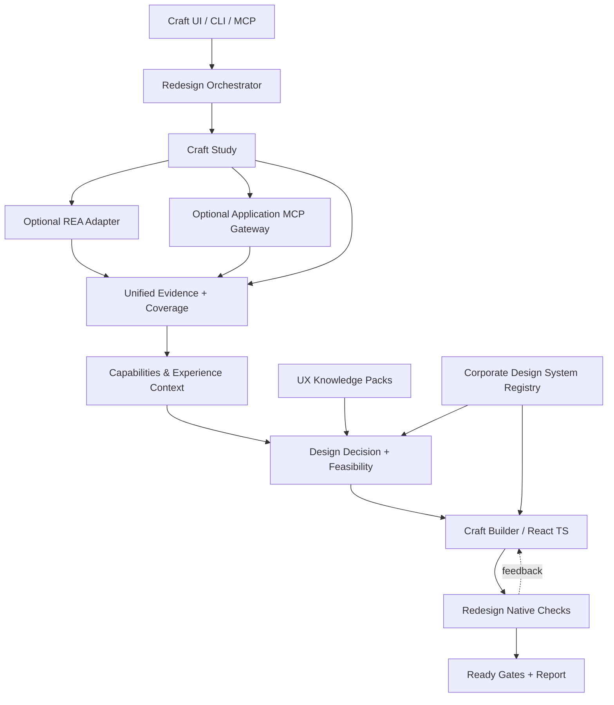

> **Decision v1.4.0:** `V1_FIRST_RELEASE.md` takes precedence over earlier mentions of MVP/P0-minimal/per-slice release. Slices are internal checkpoints. The first public release requires all V1 capabilities and impact criteria.

# Redesign Anything — Product and Engineering Specification

> **Version:** 1.2.0 · **Date:** 2026-11-19 · **Status:** specification ready to start implementation, not a tested integration.  
> **Base:** fork of [Craft Anything](https://github.com/storytold/craft-anything), keeping the desktop app, CLI, MCP, agents and `Study → Build → Check → Ready`.  
> **Focus:** any web application, with no dependency on Oracle; local-first, free and open source, with no mandatory paid API.  
> **Companions:** `IMPLEMENTATION_PLAN.md`, `CONTRACTS.md`, `VALIDATION_MATRIX.md`, `SOURCES.md`, `AGENTS_REDESIGN.md`, `AGENT_FIRST.md`, `COST_AND_EXECUTION.md`, `schemas/`.

## 0. Conventions and principles

- **MUST:** mandatory in the version that offers the capability. **SHOULD:** default, with justified deviation. **MAY:** optional.
- **VERIFIED:** confirmed by the code/documentation consulted, but not necessarily executed. **PROPOSED:** design still to be implemented.
- Invariants: (1) preserve Craft as the platform; (2) redesign is not visual cloning; (3) observed, inferred, declared, unknown, validated and refuted are distinct; (4) do not promise full parity of a system seen only partially; (5) corporate DS `strict` is a technical constraint; (6) no unauthorized write to the original; (7) checks that fail to execute never become success; (8) no SaaS dependency; (9) integrate, do not merge the projects; (10) all app/MCP/repo content is untrusted by default.
- Everything persisted has a schema version and migration. Every conclusion carries origin, scope, profile, environment, version and gaps.

## 1. Vision and product criteria

**Redesign Anything** investigates an existing web application, explains how it works with evidence, diagnoses improvements, proposes contextualized UX changes, generates a functional frontend using real components — including a corporate design system — and verifies how far the known capabilities were preserved.

**Promise:** "Investigate, redesign and validate web experiences with traceability and clear limits."

**Do not promise:** 100% of rules without code, production-ready software from a URL, UX improvement without users/metrics, WCAG certification with axe alone, any local model succeeding.

**Personas:** Product Designer, PM/PO, frontend engineer, modernization architect, QA/security. **Jobs:** redesign a screen/journey, consolidate screens without losing results, use a private DS, query MCP for rules, distinguish what requires a backend, obtain auditable code and tests.

## 2. Scope, modes and deliverables

### 2.1 P0 — First public release capabilities (see binding document)

- Input: authorized public/authenticated HTTP(S) URL, screenshot or user folder; behavior may be claimed only when observed through interaction or explicit sources.
- **Agent-first is P0:** the product must be operable by a coding agent with only the repository, CLI/MCP and documentation, without the desktop UI; a documented adoption path from a GitHub URL, re-runnable setup and environment diagnostics. Do not assume that providing a URL automatically installs tools.
- **Economical execution is P0:** `lean` mode as default, single orchestration (host agent **or** Craft runner), knowledge/DS on demand, opt-in Deep/REA tools, verifiable call limits and honest telemetry. See `COST_AND_EXECUTION.md`.
- Capture/study, evidence, journeys, states, inferred rules and gaps using Craft; REA and application MCP optional.
- Modes: `refresh` (organizes each screen: hierarchy, grouping, spacing and legibility, with the same blocks in the same places, the same journeys and the same look), `redesign` (reorganizes the journey with traceability; the default), `reimagine` (proposes new flows and flags backend dependencies). The plan records one mode; `mode_scope` compares the plan with it and warns when the plan goes out of scope. An unknown mode is refused.
- Local, versioned UX knowledge; Design Decision Engine, Critic; Corporate DS Registry with `strict` and `advisory`.
- React + TypeScript generation, Vite by default, synthetic mocks/data and real DS components.
- Objective checks: build, DS, known journeys, automated accessibility, technical/security risk and a coverage report.
- UI practically the same as Craft's: a Redesign option, progressive parameters, steps and preview; no custom canvas required in V1.

### 2.2 P1 / P2

P1: deeper Storybook/TypeScript import, semantic REA + traffic, application MCP, multiple roles, stateful simulation and impact analysis, editing an existing project. P2: video as a full input, collaborative visual comparator, optional Figma, other frameworks, backend migration, remote collaboration.

**Outside P0:** self-generated production backend; destructive production changes; cloning brands/assets without rights; guaranteed discovery of server-side logic that is not exposed; SaaS hosting; including the AGPL Layout Studio in the core without legal evaluation.

### 2.3 Ready levels

- `concept_ready`: navigable interface with hypotheses, mocks and explicit limitations; no promise of parity.
- `prototype_ready`: executable build, **known critical scenarios in scope** passed, valid DS and simulated data clearly identified.
- `engineering_ready`: checks required by the scope, satisfactory contracts and tests; **ready for review/integration, not certified for production**.
- `blocked`: security error, permission error or mandatory requirement failure. `needs_evidence`: missing evidence prevents the requested claim, but not necessarily a limited prototype.

## 3. Craft baseline: mandatory reuse

Craft's code/docs confirm: Rust/egui + CLI/MCP; `TargetKind`, `Check` and `ToolSpec`; local/remote MCP plugins; optional WASM; `Workspace` with `capture/`, `app/`, `checks/`, `investigation.cany/`, `inbox/`; browser capture, states, walkthrough, JS and traffic stand-in; runners and iterative reviews. **Do not reimplement these capabilities.**

Extension base code:

- `crates/ai/src/rebuild/kinds/`: `TargetKind`, `KindRegistry`, `Check`, `CheckCx`; new project type `redesign` [NEW].
- `crates/ai/src/rebuild/brief.rs`: contextual brief, no monolithic prompt [EXTEND].
- `crates/ai/src/rebuild/mod.rs` and the `study/check` workflow: existing orchestration [EXTEND THROUGH THE SEAMS].
- `crates/engine/src/tools/<area>.rs` + `tools/mod.rs`: new `ToolSpec`s and registration for CLI/MCP [NEW].
- `crates/ai/src/rebuild/stacks.toml`: library/stack only if really necessary; reuse existing React/TS when available.
- `crates/ui-egui/src/`: Redesign selection, DS and reports, keeping a thin UI.
- `crates/engine/src/workspace*` or equivalent owner: versioned files, migrations and the project directory.

**Confirmed cautions:** (a) the default site check examines the start page and up to 12 linked pages, not the whole application; (b) in the code of `plugin_check.rs`, a WASM plugin execution failure is reported as `passed=true`. Redesign's mandatory checks MUST be native/fail-closed or require an explicit change to that semantics; (c) Craft's Clean Room is not an OS sandbox; (d) use of Deep tools requires consent; (e) the upstream `AGENTS.md` imposes standards for originality, safe Rust, layers and roadmap — adapt it to the fork before coding, preserving the security controls.

## 4. Logical architecture and responsibilities



**Craft:** lifecycle, browser, CLI/MCP, UI, agent, build runner, pause/resume. **Redesign:** semantic models, UX decisions, DS, gating, traceability, trust instruments. **REA:** selective Deep study of JS/routes/endpoints/captures/environments. **Layout CLI:** provides the DS and auxiliary checks; it does not decide conformance on its own. **App MCP:** declares functional information according to permissions; it is not absolute truth.

**One controller per run:** in `host_agent`, Cursor/Claude/Codex already controls the reasoning, editing and tools; the MCP/CLI integration only provides capabilities and **does not automatically start** Craft's internal builder. In `craft_runner`, Craft's runner is the sole controller, and REA/Layout/app MCP are passive providers. `controller_conflict` prevents a nested Build call; handoff requires explicit approval and a checkpoint. `lean` is the default independent of `clean_room`; `deep` requires separate authorization. Routing and detailed limits are in `COST_AND_EXECUTION.md`.

**Processes:** Rust core; Node sidecars only when activated, subprocesses always through `craft_anything_platform::process` with deadlines, cancellation, output limits and isolation; no mandatory central cloud service. Node runtime compatible with the selected REA and pinned versions; Rust follows the checkout baseline (README consulted: 1.97+). Do not add a mandatory central server database to V1. `model.use_craft_selected_backend` applies only to `craft_runner`; in `host_agent` it must be `false` and the host's model is the only active one.

**Investigation modes:** `clean_room` uses only the visitor/operator surface; `deep` may inspect JS, network and internal structures with approval. Querying an MCP that reveals internal rules must be a separate consent and carry provenance, not a silent bypass of Clean Room mode.

## 5. Persistence, contracts and semantic model

### 5.1 Project organization [PROPOSAL]

Preserve Craft's native directories. Add only `redesign/`:

```text
<workspace>/
  craft.json                  # existing; add versioned fields only if necessary
  capture/                    # Craft, without duplicating
  app/                        # generated project or project authorized for editing
  checks/                     # Craft
  investigation.cany/         # Craft / evidence
  inbox/                      # Craft / approval requests
  redesign/
    config.json               # policy and context, no credentials
    study-snapshot.json       # target/environment/profile/version/scope
    capabilities.json         # known capabilities and unknowns
    rules.json                # observed/declared/inferred rules
    evidence-index.json       # refs to proofs in Craft and in adapters
    coverage.json             # explicit denominators
    ds/registry.json          # approved components/tokens/contracts/imports
    knowledge-lock.json       # packs, versions, licenses and hashes
    decisions.json            # tradeoffs and justifications
    transformation-plan.json  # origin -> redesign + feasibility + tests
    traceability.json         # requirements/capabilities -> artifacts -> checks
    scenarios.json            # test scripts and oracles
    check-results.json        # deterministic results and Critic results, separate
    usage.json                # versioned consumption snapshots (nullable where not observable)
    report.md                 # engineering report
    private/                  # ONLY sensitive local artifacts, gitignored
```

Each artifact has `schema_version`, `project_id`, `revision`, `generated_at`, `source_refs` and size limits. Atomic writes, `tmp → fsync → rename`, migration and explainable failure. Relative paths are restricted to the workspace root. `redesign/private/` is not exported by default; do not store credentials there. Individual artifacts may use paginated JSONL when voluminous, but without exposing millions of lines in the agent's context.

### 5.2 Main entities

The full contracts are in `CONTRACTS.md` and `schemas/`.

- **EvidenceRecord:** stable id, origin (`craft`, `rea`, `app_mcp`, `user`, `source_repo`, `test`), type, location, capture identity, digest, scope, data class, state (`observed`, `declared`, `inferred`, `unknown`, `validated`, `refuted`), completeness, timestamp.
- **Capability:** goal/task; actor/profile; preconditions; inputs; actions; results; states; original screens; evidence_ids; criticality; test/oracle; coverage status.
- **BusinessRule:** text, optional formal expression, conditions and transitions, origin, status, conflicts and application constraints.
- **ExperienceContext:** actors, task frequency and criticality, data volume, operational constraints, existing metrics; `unknown` when not provided.
- **DesignSystemRegistry:** real components with package/import path, version, props and variants, states, examples, usage rules, tokens and provenance.
- **DesignDecision:** problem, alternatives including `keep_as_is`, evidence, UX rules used, choice, risks, impact, test criteria and human confirmation.
- **TransformationPlan:** original capabilities → generated routes/components/actions, feasibility type, backend dependencies, mandatory preservations, check IDs.
- **ScenarioOracle:** action/input/prior state/expected result, evidence providers and simulation constraints.
- **CheckResult:** `pass`, `fail`, `warn`, `blocked`, `not_evaluated`; severity, execution, sanitized logs, evidence_ids, applicable gate.

**Prohibition:** do not record a behavior observation and an LLM conclusion in the same field without an explicit origin. Do not use self-assigned numeric confidence as proof.

### 5.3 Confidence & Coverage Engine

- Required denominators: `known_capabilities`, `scoped_capabilities`, `scenarios_with_oracle`, `scenarios_executed`, `scenarios_passed`, `roles_examined`, `states_examined`, `routes_examined`.
- `tested_coverage = passed_known_scenarios / scenarios_with_oracle`, never "% of the application". If the denominator is zero → `unknown`, not `100%`.
- `discovery_coverage` = capabilities enumerated in scope + states/journeys inspected; the denominator must be declared, not extrapolated.
- Qualitative confidence: `observed`, `inferred`, `declared`, `corroborated`, `contradicted`, `unknown`; combine independent sources without erasing conflicts.
- When Craft/REA/MCP disagree, create a `conflict` linked to versions/profiles and open a question. The MCP source does not automatically win over observation, and vice versa.
- Unverified rules must be visible in reports and builder briefings, without claiming they are proven invariants.

## 6. Corporate Design System Registry

### 6.1 Accepted inputs

Priority: (a) real React repository/package with permissions; (b) Storybook; (c) DTCG/CSS tokens and documentation; (d) Layout CLI and kit import; (e) open source UI kit if there is no corporate one. Figma is an optional provider, not a prerequisite.

### 6.2 Registry compilation

1. Locate `package.json`, lockfile, exports, components and version; never assume the API name from appearance.
2. Extract signatures/props/variants when possible via TypeScript AST or Storybook metadata, without executing unknown code.
3. Read DTCG 2025.10 tokens or convert supported sources; record theme, density, contrast and aliases.
4. Ingest documentation with source, version, license and `usage`, `never`, `a11y`, `patterns`.
5. Resolve allowed components via `ComponentId`, `importPath`, `packageVersion`, `propsSchema` and `evidenceRefs`.
6. Produce `registry.json` signed by content digest; changes invalidate verification of the previous version.
7. Expose via the internal provider `redesign_ds_list_components`, `redesign_ds_get_component`, `redesign_ds_get_tokens`.

### 6.3 Enforcement policy

- `strict`: allowed components **only**; nonexistent components → `blocked` or an approved extension request. Do not create generic HTML that visually resembles a corporate component when an official component exists. Imports, props, events, tokens, theme and version verified by code analysis and by running build/tests.
- `advisory`: suggestions, with exceptions explicitly recorded and justified.
- Hierarchy: mandatory integrity, security and accessibility > corporate policies > product goal > generic patterns. Unresolvable conflicts require human approval.
- `Layout check_compliance` is auxiliary evidence, **not** a certificate. Our additional checker identifies forbidden imports, hardcoded tokens/colors, incompatible props, duplicate components and wrong versions.
- Component tests in context: empty, loading, error, disabled states, focus/keyboard, data density and responsiveness.

### 6.4 Example

In a listing task with filters, the agent receives the context that `@corp/ui` contains `DataTable`, `FilterBar` and `BulkActions`, with real import paths and props. It must reuse them, not create `MyTable` with the same appearance. If the corporate version does not support bulk selection, record the limitation and propose an alternative; do not invent a nonexistent property.

## 7. Design Intelligence Engine

### 7.1 Knowledge Packs

- Primary source: open, licensed bases (UI/UX Pro Max, PatternFly/Carbon under their specific license, Open UI, DTCG, public WCAG standards); **do not copy proprietary materials in full**.
- Versioned pack with `id`, `version`, `license`, `source_url`, `retrieved_at`, `hash`, `domains`, `tasks`, `applicability`, `contraindications`, `examples`, `tests`, `reliability`.
- Structure: `ux-core`, `enterprise-data`, `forms-validation`, `navigation-ia`, `dashboards`, `accessibility`, `density-productivity`, `mobile-responsive`, `content-localization`, `industry-patterns`.
- Knowledge selection: rules/tags and local text search (SQLite FTS5 or equivalent) as the baseline; embeddings are optional and not a V1 dependency. Small, targeted context.
- Golden rule: no pack converts a heuristic into a legal obligation; the report distinguishes standard, corporate constraint and hypothesis.

### 7.2 Design Decision Engine

Typed pipeline: `diagnose` → `retrieve_rules` → `generate_alternatives` → `evaluate_tradeoffs` → `check_feasibility` → `select_or_ask` → `record_decision` → `build_guide`.

The evaluation considers: task, profile and experience, frequency, density, cognitive cost, error risk, interoperability, accessibility, available component, technical effects and supplied metrics. It generates at least the `keep_as_is` option and, when requested, contrasting alternatives. Do not force wizard, cards or sidebar menu as a universal template.

### 7.3 Design Critic

- Agent or role separate from the generator, with inputs: evidence, transformation, DS, screenshots of the new version, tests executed.
- Structural critique of tasks, hierarchy, density, shortcuts, states, errors and navigation; each finding contains evidence, impact and a recommendation.
- Critique is `warn`/recommendation until an objective test or explicit policy exists; it **cannot invent technical approval**.
- The critique may propose an experiment; it does not turn aesthetic preference into functional truth.

## 8. Application MCP Bridge and Trust Gateway

### 8.1 Connect without requiring special implementation

- Support external MCP servers via Craft's existing infrastructure, using additional trust control and classification per application, profile and project.
- A `tool` description does not imply understanding of a rule; start by listing the available `tools/resources/prompts` and discovering real capability.
- An **optional, non-MCP-standard** `App Knowledge Contract`, versioned and documented, may expose tools: `list_capabilities`, `describe_capability`, `explain_business_rule`, `list_allowed_transitions`, `get_required_fields`, `get_user_permissions`, `validate_scenario_readonly`.
- MCP `readOnlyHint`/`destructiveHint` annotations are **untrusted hints**; our policy is based on allowlist/scope/credential/approval and, for calls with effects, testing in an isolated environment.

### 8.2 Trust and authorization

- Credentials referenced by local keychain/secret manager ID; never inline in `craft.json`, prompts, HAR, logs or export.
- Pin the full fingerprint of the MCP contract (name, input/output schema when provided, annotations, origin/identity, version). Unexpected change → `contract_changed` and new approval.
- Initially `read-only` by external policy, without presuming that a tool advertised as read is truly free of effects; mutating operations blocked in production.
- Rate/timeout/output limits, tool and URL allowlist, per-category consent, sanitized audit, egress control.
- Each MCP response is `declared`, not `observed`; it must be reconciled with browser/REA/test behavior.
- MCP descriptions/responses are treated as **untrusted data** and isolated from system instructions; instructions coming from a tool do not grant additional permission.

### 8.3 Version compatibility

- `InvestigationSnapshot` records application, environment, user/profile, tenant (anonymized identifier), known flags, version id when available, tool fingerprints, DS version, browser, date/time and scope.
- Missing version at the source: record `version_unknown`; conflict between evidence from different versions must not be silently consolidated.

## 9. REA Investigation Adapter

### 9.1 Selective use and benefits

Relevant REA tools: `inspect_web_page`, `analyze_web_bundle`, `observe_web_session`, `capture_browser_scenario`, `inspect_web_network_capture`, `analyze_javascript_application`, `trace_application_feature`, `trace_javascript_semantics`, `compare_web_captures`, `export_web_scripts`, `environment-build` / coverage views. Names and availability must be validated against the **pinned version** of REA, never inferred from the latest version.

Triggers: uncertain client-side validation; non-obvious route/SPA; inconclusive form flow; unclear API contracts; divergence between observation and MCP; need for a more faithful simulated environment. If Craft already answers with sufficient evidence, do not trigger REA. Record justification, cost, deadline and differences discovered.

### 9.2 Documented REA limits

- Passive observation does not recover events prior to the activation of the CDP domains; their absence does not prove they never occurred.
- Static JS semantic analysis does not prove execution; dynamic imports, ambiguous dependencies and obfuscated code remain partial.
- Captures may truncate by window, heap, deadline and byte limit; normalize metadata and pass on `unknowns` without false successes.
- `environment-build` can create an environment with derived state, but only serves mutations whose effects are grounded by the captures; unmodeled writes are `withheld`.
- CDP gives powerful access to the profile; use a dedicated profile, local ports, controlled origins, consent and isolation. Do not attach several tools to the same browser simultaneously without a session coordinator.

### 9.3 REA as an evidence provider

The adapter transforms external `Evidence` into `EvidenceRecord` with `external_evidence_id`, `producer_version`, `capture_digest`, `coverage`, `limitations`, `authority`, `evidence_ref`. Preserve raw data only when explicitly allowed; show projections/summaries to the agent.

### 9.4 Simulated environment

Tiered policy: (1) controlled synthetic mocks; (2) Craft's stand-in when records are sufficient; (3) REA Agent Environments if its coverage of confirmed reads/writes increases fidelity. Never use replay of real credentials as an exportable fixture. If there is no proof of write effects, mark `not_modeled` and allow only an isolated demonstration.

## 10. Feasibility & Transaction Semantics

Before building, each change receives a classification:

- `ui_only`: appearance/navigation/presentation without new backend effects.
- `frontend_orchestration`: new sequences of existing calls; requires testing of state, idempotency, partial errors, retries, race conditions and permissions.
- `backend_change_required`: requires a new endpoint, rule, transaction, authorization or capability that is not exposed; produce a proposal and a pending contract, do not pretend a complete implementation.
- `not_determined`: insufficient information; only a prototype with a labeled hypothesis, or an engineering block.

For complex flows, record operations, dependencies, preconditions, effects, **known** atomicity guarantees, idempotency, compensation/rollback and asynchronous events. Do not infer atomicity by looking only at several screens. In live integration, mutating requests only against staging/test with restricted credentials and permission.

## 11. Builder, generator and code protection

- Use Craft's agent executor. The Brief contains compact context and versions: capability map, UX plan, DS registry, invariants, unknowns, executable criteria. Limit context and retrieve references on demand; do not send the whole library/Storybook into the prompt. In `host_agent`, do not start a new model automatically.
- React + TypeScript by default. If the DS requires a different supported structure, the agent must justify it or record the incompatibility. In an existing project, use a branch/worktree and authorized staging, never alter source without confirmation.
- Suggested structure of the generated frontend: `src/app`, `src/routes`, `src/features/<capability>`, `src/components` (only if approved), `src/lib/api`, `src/lib/state`, `src/mocks`, `tests/e2e`.
- Corporate components imported through real paths. Copying their code without rights or replicating their appearance in generic wrappers to satisfy false compliance is prohibited.
- Simulation: synthetic data and an environment banner; disable production endpoints. `src/mocks` never includes extracted personal data.
- Generate states: loading, empty, invalid, error, success, disabled, permission-denied and timeout in applicable flows. Do not invent rules; unknowns visible in config/test.
- Every relevant decision records where it was implemented and which tests cover it.
- `Design Critic` is separate from `Build Check`: heuristic opinion does not make a build pass.
- Treat generated code as untrusted: package/build commands in a controlled environment, with no network/secrets by default, audited install scripts, process limits.

## 12. Validation and native redesign gates

### 12.1 Checks implemented in the `redesign` kind

| Check ID | Type | Blocking condition |
|---|---|---|
| `redesign_build_check` | Deterministic | mandatory build/typecheck failed or did not run |
| `redesign_ds_check` | Deterministic | `strict`: unauthorized import/token/props/component |
| `redesign_functional_check` | Browser/tests | critical scenarios with an oracle do not pass; missing execution = not_evaluated |
| `redesign_accessibility_check` | Automatic + review | new critical violations identified; absence of human review remains qualified |
| `redesign_security_check` | Policy and artifacts | secret exported, unauthorized egress, use of a prohibited mutating action |
| `redesign_traceability_check` | Structural | known critical capability without a destination or justification |
| `redesign_impact_check` | Differential | proven regression in a protected route of an existing project |
| `redesign_ux_critique` | Agent, advisory | heuristic finding is not a technical gate until accepted as a requirement |

Statuses are `pass`, `fail`, `warn`, `blocked`, `not_evaluated`. Each check includes `executed`, `environment`, `tool_version`, `scenario_ids`, `evidence_ids`, `started_at`, `duration_ms`, `limitations`, severity and repair route. **Never map a plugin failure to success.**

### 12.2 Criteria for the Ready levels

- Concept: compiles/renders or signals that it is a visual mock; provides decisions and limits. A security block still prevents unsanitized delivery.
- Prototype: `build=pass`, DS strict if configured `pass`, security `pass`, **100% of the critical scenarios with an oracle in scope passed**, no known critical behavior omitted without approval, valid coverage report. Other unmeasured scenarios remain visible. If there are no executable scenarios, do not qualify as Prototype Ready without explicit scope approval and an alternative designation.
- Engineering: Prototype conditions + integration contracts defined for the real parts, required suite passed, protected-route regression passed, relevant accessibility test with pending human review **not** treated as a certificate. Requires external engineering review before production.
- `blocked` always beats `ready`. A mandatory `not_evaluated` blocks qualification; only optional checks may remain qualified as not evaluated.

### 12.3 Performance and quality

- Build with strict TypeScript and executable tests; lint, consistent imports, no hardcoded values under DS strict; bundle assertions and warnings.
- Playwright: navigation, Tab/Enter/Escape keys, error messages, empty states, responsiveness, keyboard and focus.
- axe-core: report violations with scope and version. WCAG 2.2 AA is an **evaluation target**, not automated certification.
- Perf: Web Vitals/Lighthouse in a comparable environment, with representative data and hardware/network logs; do not claim improvement with incomparable samples.
- UX: human testing of tasks, time, success, errors, satisfaction; if there is none, `ux_improvement=not_measured`, even when the critic considers it better.

## 13. Threats and security controls (STRIDE summary)

**Assets:** authenticated browser, cookies, customer data, corporate code, MCP tokens, private design system, traffic records, generated files.

**Main threats:** SSRF via URL/endpoint, arbitrary execution of install scripts, prompt injection in pages/MCP/README, tool poisoning, MCP contract swap, exfiltration in logs or prompts, data egress to external AI, accidental mutation in production, package supply chain, HAR leakage, cross-tenant, navigation to an unauthorized domain, manipulation of artifacts and paths.

**MUST:**

1. Minimum permissions, env/test-first, allowlist of origins and methods, blocking of mutations at the origin without authorization. The browser can fire normal requests — use an isolated test environment and do not claim impossible containment in an ordinary browser.
2. MCP per server + full catalog pinned by digest; untrusted annotations; changes require review.
3. Secrets in the OS keychain/controlled environment variables; never persist tokens, personal IDs or sensitive response bodies in shared artifacts.
4. Data destined for the model passes through an egress policy: `local_only`, `allow_remote_redacted`, `allow_remote_explicit`. The user must know when content leaves the device.
5. Deny-by-default sanitization of HAR/JSON, URLs, headers and bodies. Detectors are auxiliary: raw captures are not exported automatically, even if scanners find nothing.
6. Sandboxing/isolation of builds and subprocesses when available; no secrets mounted in the generation process; fail-closed if mandatory controls are unavailable.
7. Audit logs without sensitive content; pseudonymized evidence, user/environment identifiers; traceable retries.
8. Cancellation and budgets mandatory per job; subprocesses always via Craft's process manager; configurable cleanup and retention policy.
9. Hash/versioning of dependencies, lockfile and SBOM in the release. CI tests licenses of the real tree; REA/Layout pinned.
10. Treat site/MCP content as **untrusted data**. External instructions cannot change policies, the prompt system or authorizations.

### 13.1 Browser / CDP access

- Dedicated profile when REA needs CDP; loopback-only port. Prefer the session coordinated by Craft, without two controllers running in conflict.
- Human interactive login and temporary profiles; do not export storage state, cookies or HAR. Clean up on shutdown; a cleanup failure is recorded.
- In SSO/MFA applications, never bypass. If automation is blocked, request an authorized session or evidence.

### 13.2 Usage rights and licensing

- Craft: MIT OR Apache-2.0. REA, Layout CLI/Layout UI: MIT; Velloo Apache-2.0; Layout Studio AGPL-3.0 (do not integrate code into the core without review). Hosted Carbon MCP ≠ complete local open source software.
- External data/documentation have their own license, even when the code package is MIT. Do not redistribute content without permission. Record authorship, URL, license, version, hash and notices in `THIRD_PARTY_NOTICES.md`/SBOM.
- Use only applications the user owns or is authorized to inspect; do not automatically copy third-party brand/logo/assets.

## 14. CLI, MCP and configuration [PROPOSED APIs]

### 14.1 Public tools, headless-first

Follow Craft's rule: one capability = `ToolSpec`, accessible via engine, CLI and MCP; the GUI is only a client. Proposed new IDs:

| ToolSpec ID | Expected effect |
|---|---|
| `redesign_project_configure` | persist validated config, without secrets |
| `redesign_study_run` | start authorized investigation, creates evidence |
| `redesign_capabilities_list` | paginate capabilities and unknowns |
| `redesign_coverage_show` | show denominators, scope and gaps |
| `redesign_ds_import` | import registry with source approval |
| `redesign_ds_check` | verify code conformance |
| `redesign_app_context_query` | query authorized MCP through a gateway |
| `redesign_rea_probe` | optional, authorized REA probe, return evidence |
| `redesign_plan_generate` | create alternatives/decisions/feasibility |
| `redesign_plan_approve` | record explicit approval for a change |
| `redesign_build_run` | direct to Craft's existing runner |
| `redesign_checks_run` | run native checks, without textual approval |
| `redesign_report_export` | generate a sanitized report and artifact list |

The final set of `ToolSpec`s must avoid artificial wrappers when the command already exists in Craft. Do not duplicate the runner API; create a *facade* only for coordination and contracts. `list` tools must offer `offset`, `limit`, filters and payload limits.

### 14.2 Proposed CLI

Commands **to be implemented in the fork**; do not claim they already exist:

```bash
# In the first PR, keep the Craft binary; rename/alias in the distribution phase.
craft-anything-cli redesign init https://app.example.test \
  --mode redesign --capture clean-room --project-folder ./project
craft-anything-cli redesign study --project-folder ./project
craft-anything-cli redesign ds import --project-folder ./project \
  --source ./corporate-design-system --policy strict
craft-anything-cli redesign plan --project-folder ./project
craft-anything-cli redesign build --project-folder ./project
craft-anything-cli redesign check --project-folder ./project
craft-anything-cli redesign report --project-folder ./project
```

Revalidate the existing CLI's conventions and prefer subcommands that use `ToolSpec`; do not insert arbitrary flags into the core without parser adaptation and tests. The final packaging may expose `redesign-anything` as an alias/documentation without replacing a ready tool prematurely.

### 14.3 Configuration example

```json
{
  "schema_version": "1.0.0",
  "project_id": "redesign-demo",
  "target": {"kind": "website", "url": "https://app.example.test"},
  "mode": "redesign",
  "capture_mode": "clean_room",
  "scope": {"max_routes": 12, "max_journeys": 5, "roles": ["operator"]},
  "design_system": {"kind": "local_repo", "source": "./corporate-ui", "policy": "strict"},
  "providers": {"rea": "disabled", "application_mcp": "disabled"},
  "backend": {"mode": "mock", "allow_production_writes": false},
  "model": {"use_craft_selected_backend": false},
  "execution": {"controller": "host_agent", "profile": "lean", "allow_nested_builder": false,
    "budgets": {"token_soft_limit": 750000, "max_mcp_calls": 30, "max_rea_invocations": 2,
      "max_critic_passes": 1, "max_tool_result_chars": 12000, "max_run_minutes": 90, "no_progress_limit": 2}},
  "privacy": {"model_egress": "local_only", "export_raw_captures": false},
  "checks": {"max_refine_rounds": 3, "require_critical_scenarios": true}
}
```

These defaults are **proposed**, not observed performance numbers. The real schemas must validate URL, scope, enumerations and references; `local_only` with a remote agent is an incompatibility and must block until explicitly adjusted.

### 14.4 Agent-first use and bootstrap from a GitHub repository — mandatory P0 requirement

**Central use case:** someone pastes the Redesign Anything repository URL into Cursor/Claude Code/Codex/ACP and asks the agent to use it, as they already do with Craft. A GitHub URL is a discovery entry, not an executable installation. The agent must obtain the repository through permitted mechanisms, read trust documents and complete prerequisites with consent.

**The distribution package MUST contain** a README with an agent quickstart, the product's `AGENTS.md`, `docs/AGENT_FIRST.md` (this kit includes `AGENT_FIRST.md`), an adapted `docs/extending.md`, documented CLI and MCP, configuration examples, offline fixtures and a headless `doctor`. It MAY offer a portable `skills/redesign-anything/SKILL.md`, provided it does not break agents that do not implement Skills. No capability will depend on an egui window.

**Flow contract:**

1. The agent receives the Redesign Anything repository URL; validates origin/commit and obtains the code through authorized Git/checkout.
2. It reads the README/`AGENTS.md`/agent-first guide and runs a diagnostic **without altering the system** (`doctor --json`, exact syntax after implementation).
3. It reports missing prerequisites and requests consent before installing dependencies, running third-party programs, accessing an authenticated browser or configuring MCP.
4. It allows invoking redesign via the CLI or exposing the same operations via MCP; lists and calls `redesign_*` without a UI. It avoids duplicating the Craft workflow.
5. It returns local artifacts in the project, status, evidence, test scenario, coverage report and limitations, including when the process is interrupted.
6. On resumption, it preserves the project, version and evidence instead of repeating capture and altering answers without recording.

**Future command (PROPOSED, not implemented):** `redesign-anything-cli redesign --url <url> --mode redesign --config <path>`; the executable name and flags MUST be confirmed against the fork's real binaries in PR-01. The planned MCP tools are in section 14.

**Acceptance criteria:** a clean machine with Git, Rust and documented OS dependencies; the agent can follow only the repository's instructions, prepare the CLI, identify the absence of browsers/Node/REA/Layout and run the P0 fixture without opening the desktop app. The flow also works when REA/Layout/application MCP are not installed. All installations and actions with effects are explicit; no script obtained from the web is run implicitly.

**Ergonomics layer:** the `README` offers three copyable prompts: (a) prepare installation; (b) redesign URL + DS; (c) validate a saved project. We must measure from the start the friction of pasting a URL into the agent versus starting from a preinstalled MCP.

## 15. Observability, cost control and errors

**Canonical contract:** `COST_AND_EXECUTION.md`. The host agent's token budget is only **advisory** when its client does not provide usage telemetry. Limits that actually apply to tools/sidecars executed by Redesign are hard; no report may treat unobservable tokens as zero.

- Structured event per step (`study_started`, `capture_completed`, `mcp_query_approved`, `rea_probe_completed`, `decision_recorded`, `build_started`, `check_completed`, `ready_gate_evaluated`) without sensitive data.
- Metrics: duration per step, REA/MCP calls, input/output/cache tokens **when reported**, accounting quality, cost only when provable, operations not executed, calls and cache hits, scope coverage, rounds, checks and unknowns. Do not add cached input twice.
- Configurable limits for routes, depth, scenarios, artifacts, MCP/REA calls, number of critiques, time per process, refinements and tool payload. `token_soft_limit` is a **warning**: a hard cap only when there is a counter and control to stop the model; otherwise `warning_unenforceable`. The UI and CLI show limits before a potentially long investigation.
- `budget_exhausted`: preserve partial progress and return its own `budget_exhausted` state with `needs_evidence` where pertinent; do not convert unknown checks into `pass` nor treat unobservable token usage as a satisfied limit.
- Retry only for transient/idempotent failure; calls with effects are never retried automatically without an idempotency key and authorization.
- Determinism: pinned versions, capture dates, seeds, screen sizes, fixture, environment and locale. The model may vary, but every objective verification is re-executable.

**Planning estimates, not measurements:** simple screen 150–400k processed tokens; corporate screen 400k–1.2 million; journey of 3–5 screens 1–3 million; module of 10–20 screens 3–10 million; large application above that. They include repeated context and can vary widely. They are not equivalent to the context window nor to the billed cost. The experimental *defaults*, with no guarantee of enforcement for an external agent, are in `COST_AND_EXECUTION.md`. Craft documented cache-usage tests and expensive loops in `docs/ROADMAP.md` (R5.3/R5.4): record the baseline before establishing numeric criteria.

## 16. Reference E2E and acceptance journey

**Additional mandatory test:** run the same fixture with the host agent as the sole controller, validate that `rebuild_start` is not started by default and report host tokens as `unavailable` when there is no metadata. The comparison of Craft vs Lean vs Deep is in `COST_AND_EXECUTION.md` and `VALIDATION_MATRIX.md`.

An open source fixture application built for the test, with rules published separately from the inspected version:

- Generic request management: dense listing, filters, pagination, editing, detail, state workflow, dependent validations, permissions (operator/approver), errors and effects persisted in the test backend.
- Corporate design system fixture: React/TS package with DataTable, FilterBar, FormField, StatusBadge, Dialog, Toast, DTCG tokens and Storybook, including deliberately incompatible variants/props.
- Application MCP fixture: two read-only tools with declared rules and one mutating tool blocked in production; a malicious tool for prompt-injection testing.
- REA fixture: distributed JavaScript with SPA routes and validation; synthetic HAR with a canary token (not real) and confirmed/unconfirmed write scenarios.

**P0 acceptance journey:**

1. The user opens the Craft fork → selects Redesign, fixture URL, Redesign mode, strict corporate DS.
2. Study maps 1 critical journey, evidence, unknowns and errors, with no access to source code.
3. Plan proposes a justified reorganization, `keep_as_is`, preservations and feasibility.
4. Build generates React/TS using real DS imports, with synthetic data and a functional flow.
5. Check detects an intentional regression, refines once and approves only after the tests pass.
6. Export includes the project, decisions, coverage with denominator, risks, limitations, licenses and sanitized logs.
7. A security test confirms there was no write to the original application and no secret in the artifacts.
8. With REA off, P0 continues; with REA enabled, it records a gain only if there is new evidence.

**P0 acceptance:** build and tests pass; zero blocking DS/safety violations; no mutating call to the original; 100% of the **defined and executable critical scenarios in scope** pass; every known critical capability has a destination or an approved exception; unknowns and sources visible. Do not require the AI to discover unknown rules.

## 17. Delivery plan and dependencies

`IMPLEMENTATION_PLAN.md` contains small PRs, files, tests and acceptance criteria. Summary:

1. PR-00: fork, licenses, tested baseline and adaptations of `AGENTS.md`/roadmap.
2. PR-01: `RedesignKind`, defaults and a minimal headless command.
3. PR-02: `redesign/` workspace, schemas, migrations, status and source refs.
4. PR-03: Study adapter + Capability/Evidence/Coverage.
5. PR-04: Knowledge Packs + typed retrieval, basic critic.
6. PR-05: DS Registry + Layout CLI integration + strict compliance.
7. PR-06: Plan/Feasibility/Traceability + decision approval.
8. PR-07: React/TS Build + briefing + mock/synthetic data.
9. PR-08: fail-closed native checks + Playwright/axe + Ready gates.
10. PR-09: Application MCP Bridge and Trust Gateway.
11. PR-10: REA deep adapter and incremental evaluation; simulated environments if a gain is proven.
12. PR-11: multi-profile E2E benchmark + security + scaling.
13. PR-12: Craft UI polish, distribution/packaging, SBOM, documentation and release.

Order matters: **PR-00 → PR-03 → PR-05 → PR-08** closes the value path before adding several integrations. If an additional dependency does not raise metrics against the baseline, keep it as an optional plugin.

## 18. Definition of done, uncertainties and final decision

### 18.1 For each PR

- Code compiles; unit/integration tests added; a new versioned file has migration/validation.
- Appropriate Craft commands pass (`cargo fmt`, clippy, test, `cargo xtask layers`, locks, wasm when touching L0–L2, secrets and i18n checks when relevant). Revalidate syntax in the checkout.
- No new execution path bypasses consent, improperly cancels jobs or invades Clean Room.
- `AGENTS.md`, roadmap/status/tools documentation updated in the fork; live test described as executed or not.
- Fallbacks and errors exercised; security checks fail closed.
- The PR does not alter Craft's traditional cloning functionality without a regression test.

### 18.2 Decisions already made

- **Craft fork** architecture, not an independent platform.
- Differentiator: Design Intelligence, corporate DS, transformation and verification — not duplicated reverse engineering.
- REA/application MCP optional, knowledge by sources, controlled egress.
- React/TypeScript and web UX as the first target; future platforms can reuse the engine.
- Three Ready levels and `Confidence & Coverage` mandatory, with honest epistemology.
- Low cost, free/open source, no mandatory paid API; local inference may be limited.

### 18.3 Questions to **measure**, not to decide by guesswork

- Which model/agent, local or authenticated, can execute a useful Redesign + Check chain on real hardware?
- How much does REA add to rule coverage relative to Craft alone, per unit of effort/time?
- Which Storybook/TypeScript limitations can the Registry not capture for the target DS?
- In which application patterns does consolidating flows worsen productivity?
- What is the false-positive/false-negative rate of the parity and DS gates?
- What is the acceptable time/cost of discovery with 5, 20, 100 routes and several profiles?
- How do we package signed and verified sidecars on Windows/macOS/Linux without installing packages silently?

### 18.4 Limits that cannot be resolved generically

No finite observation guarantees discovering rules that were never exercised; no MCP necessarily knows how to explain internal rules; no simulation guaranteeably reproduces backend effects that were not observed; there is no proof of "better UX" without evidence/evaluation of use; no automated suite proves the universal absence of bugs, security flaws or full WCAG conformance. The product exposes these boundaries as part of the delivery.

## 19. Canonical references and reading before implementation

- Craft [`README`](https://github.com/storytold/craft-anything/blob/main/README.md), [`AGENTS.md`](https://github.com/storytold/craft-anything/blob/main/AGENTS.md), [`docs/extending.md`](https://github.com/storytold/craft-anything/blob/main/docs/extending.md), [`kinds/mod.rs`](https://github.com/storytold/craft-anything/blob/main/crates/ai/src/rebuild/kinds/mod.rs), [`plugin_check.rs`](https://github.com/storytold/craft-anything/blob/main/crates/ai/src/rebuild/kinds/plugin_check.rs), [`docs/STATUS.md`](https://github.com/storytold/craft-anything/blob/main/docs/STATUS.md), [`docs/ROADMAP.md`](https://github.com/storytold/craft-anything/blob/main/docs/ROADMAP.md).
- REA [`README`](https://github.com/morluto/rea/blob/main/README.md), [`browser observation`](https://github.com/morluto/rea/blob/main/docs/guides/web/browser-observation.md), [`JS semantics`](https://github.com/morluto/rea/blob/main/docs/guides/javascript/javascript-application-workflows.md), [`agent environments`](https://github.com/morluto/rea/blob/main/docs/agent-environments.md).
- Layout CLI [`README`](https://github.com/uselayout/cli/blob/main/README.md), [`LICENSE`](https://github.com/uselayout/cli/blob/main/LICENSE); Layout UI [`README`](https://github.com/uselayout/ui/blob/main/README.md).
- W3C [Design Tokens 2025.10](https://www.w3.org/community/reports/design-tokens/CG-FINAL-format-20251028/); [WCAG 2.2](https://www.w3.org/TR/WCAG22/); [Understanding Conformance](https://www.w3.org/WAI/WCAG22/Understanding/conformance).
- MCP [tool annotations and risk](https://blog.modelcontextprotocol.io/posts/2026-03-16-tool-annotations/); OWASP [MCP Security Cheat Sheet](https://cheatsheetseries.owasp.org/cheatsheets/MCP_Security_Cheat_Sheet.html).


## 20. Binding addendum v1.2.0 — critical council review

> **Precedence:** this section and `COUNCIL_DECISIONS.md` take precedence over v1.1.0 scope/order descriptions that contradict them. The 1.0.0 schemas remain compatible; Task Model changes are initially optional files and do NOT make the previous configuration format invalid.

### 20.1 Thesis and differentiation criterion

The product is not a promise of full system modernization from a URL. It is an **open source, evidence-based agent for redesigning web interfaces and journeys, which produces verifiable code and explicit limitations**. The hypothesis to demonstrate is that, for the same application, agent, model, budget and criteria, REA outperforms (A) Craft with a plain prompt and (B) Craft with structured UX instructions in at least one relevant outcome without critical regressions. **If B reaches equivalent performance, simplify to skill + checks instead of keeping unnecessary subsystems.**

### 20.2 Mandatory first internal vertical slice (not a public release)

The first internal technical checkpoint is: authorized URL/fixture → Study reused from Craft → minimal Task Model → diagnosis with evidence → proposal including `keep_as_is` → React/TS build → essential checks (build, functional smoke, provenance and coverage honesty) → Concept/Prototype Ready report. CLI/MCP in `host_agent`, no mandatory desktop. **This milestone does not authorize publishing V1.** Corporate DS, rich intelligence, REA, Application MCP, journeys and quality are capabilities required before the first public release, with selective activation per `V1_FIRST_RELEASE.md`.

### 20.3 Task Model and content

Each journey under evaluation MUST record `task_id`, goal, persona/role when known, frequency (`unknown` is valid), criticality, volume, preconditions, expected results, dependencies, source and before/after metrics when available. Fields without evidence stay `unknown`; do not infer metrics. Content quality includes labels, domain terminology, microcopy, error messages, empty states and clear language; textual decisions must reference evidence or a hypothesis.

### 20.4 Design System Policy with three categories

`required_component`: official component mandatory for a covered function; `allowed_composition`: authorized structural composition, without duplicating official components; `extension_requires_approval`: a gap with an explicit proposal and approval. The `strict` policy applies these categories and **does not automatically prohibit all HTML markup with no equivalent in the registry**. Tests verify import, props, version, tokens, state semantics and justification of an exception. The legacy `strict/advisory` configuration remains valid.

### 20.5 Evidence of improvement and criticality

Deterministic checks prove only their own criteria; Design Critic/LLM judge provide recommendations, not certification. The evaluation protocol must include representative tasks, preservation of results, success/time/errors when measurable, manual accessibility when applicable, content, density and the `keep_as_is` option. Do not claim a UX gain without a benchmark or user study. Failure of a known critical functional scenario prevents `prototype_ready`, regardless of appearance.

### 20.6 Execution governance and early stopping

Keep the single controller `host_agent` XOR `craft_runner`, Lean mode and optional REA/MCP. Record calls, time, payloads, progress in checks and tokens when available. Stop repeated refinement without objective improvement; when counters are not observable, use effective limits on time/calls/rounds, reporting `usage=unavailable`, never a fictitious zero. Do not impose token budgets as guaranteed limits if the backend does not allow enforcement.

### 20.7 Simplification and stopping triggers

Reevaluate the fork if the extension requires intrusive changes to the core; reevaluate the Design Engine if it does not outperform baseline B; discard REA/optional integration without marginal gain; stop expansion when there is loss of critical functions, a risk to sensitive data or uncontrolled execution. Record decisions in an ADR with evidence and an owner. Quantitative criteria will be defined **before** the benchmark, not after seeing results.

### 20.8 Security and product conditions

Do not run untrusted installs/scripts without approval and isolation; segregate projects and credentials; prevent export of sessions and private data; apply an authorization scope per project. `Engineering Ready` continues to mean ready for review and integration, **never automatic production approval**. The product may return `needs_evidence` and `keep_as_is` as valid results.

## Normative addendum v1.3.0 — Council II controls

**Precedence:** in conflict with earlier sections, `TRUST_BOUNDARIES.md`, `ORACLE_POLICY.md`, `SAFE_WORKSPACE_POLICY.md` and `OSS_DX_AND_UPSTREAM.md` prevail. These rules are implementation requirements, not proven features.

1. `host_agent` does not imply a global sandbox. The product limits only its own tools; the agent's external commands remain under the host's policies.
2. Every write to the target project requires a diff and approval; the default output is an isolated workspace.
3. Parity tests use independent, traceable oracles; an LLM hypothesis is never a verified expected result.
4. Evidence includes environment, version, role, tenant, flags, origin, retention and redaction policy.
5. MCP, pages and documents are untrusted data sources, never executable instructions or approval authority.
6. Corporate design systems need version/hash, usage rights and segregated cache; private assets are not redistributed.
7. Release requires declared compatibility per agent/OS, accessibility beyond automated checks and an auditable upstream update.
8. In a divergence between security and DX, `doctor` remains free of side effects; installations require consent.
9. `Concept Ready`, `Prototype Ready` and `Engineering Ready` respect the gates of `ORACLE_POLICY.md`. No level automatically equals production.
